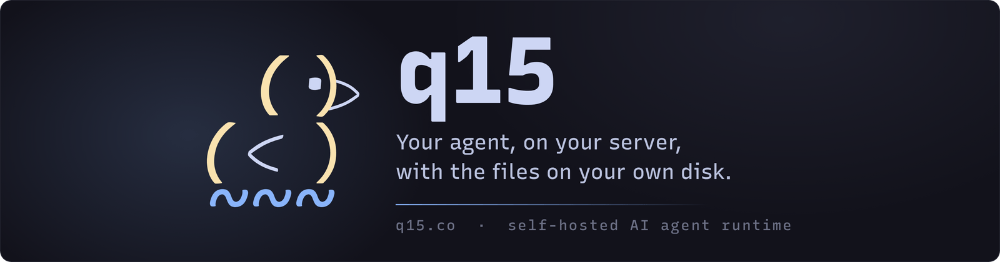

# q15

[](https://github.com/q15co/q15/actions/workflows/publish-main-images.yml)
[](LICENSE)
[](go.work)
[](https://github.com/q15co/q15/pkgs/container/q15-agent)
[](https://q15.co)



**Your agent. Your server. Your files.**

q15 is a self-hosted AI agent runtime. It runs on a Linux server you control, and it keeps
everything it produces in folders you can open: the conversation, the memory extracted from it, the
files it works on, and the jobs it runs while you are away. There is no account and no hosted
service in the middle, and the credentials it uses are held by a proxy the agent never reads.

One owner, one agent, left running. Bring an Ollama API key, your own Ollama server, or any
OpenAI-compatible endpoint, and choose the model at runtime. [Why q15](https://q15.co/why-q15/) says
what it is not, and what it does not claim to be.

## What you get

- **Two clients, one conversation.** A passkey-locked browser app with streaming chat, history and
  attachments, plus a Telegram bot. Both reach the same agent, the same transcript and the same
  memory.
- **Credentials outside the agent.** Every outbound request goes through an egress proxy that
  applies your policy and attaches the secrets. The agent, and therefore the model, never hold them.
- **Execution without a shell on your host.** Commands run inside the `q15-exec` container, in a Nix
  environment with its own package store, and reach the network only through the egress proxy.
- **A workspace that is not scratch space.** `/workspace` is a project tree that survives restarts,
  updates and redeployments. A new stack may start with it empty, and it is expected to stay
  attached.
- **Memory that accumulates.** Identity, extracted knowledge, working state and the full turn
  history live under `/memory` as files. Background jobs keep them current between conversations.
- **Work while you are away.** Scheduled jobs run unattended, each with its own model pin, its own
  tool allow-list and its own turn budget.
- **A model you can change at runtime.** Providers are declared in config and their rosters are
  discovered; the interactive model, and the model behind each background job, are runtime state.

## Install

q15 installs with four commands, on a server you control.

```bash
curl -fsSL https://q15.co/install.sh | sh
q15 init
q15 up
q15 status
```

| Command      | What it does                                                                   |
| ------------ | ------------------------------------------------------------------------------ |
| the `curl`   | One signed binary into `~/.local/bin`. No sudo, nothing installed system-wide. |
| `q15 init`   | Names the agent, picks a model, sets the address.                              |
| `q15 up`     | Renders the units, starts the stack, waits for health.                         |
| `q15 status` | What runs, and what the agent can reach.                                       |

`init` prints the address of the browser client: open it, create your passkey, and send a message.
It asks for the agent's name, the address, and the model. The name and the address are the two that
do not change afterwards; the model does.

> **The installer is not built yet.** There is no `q15` binary in any release: the tickets that
> produce it are filed and none has shipped, so those four commands do not work today. Until they
> do, [run the published images](https://q15.co/reference/#run-it-today-end-to-end) - that page has
> the Compose file, the volumes, the secret files and the health checks, and it is how every
> deployment that exists was built. [docs/deployment.md](docs/deployment.md) covers the same ground
> for a checkout of this repository, and the Development section below is the from-source route.

## Requirements

```text
FOR THIS YOU NEED
· SSH and a shell
· A DNS record, only if you want a public hostname

AND THIS
· Linux with systemd
· A rootless container runtime: podman (the default) or Docker Engine
· 2 GB RAM for the stack, plus room for the models you pick
· A model provider: an Ollama API key, your own Ollama server, or any OpenAI-compatible endpoint
· A passkey-capable authenticator, bound to a device

AND IN PROGRESS
· macOS on Apple silicon, for the q15 command and the auth verbs, not the stack
```

Four of those are worth reading twice.

**Synced passkeys are refused.** q15 needs a credential it can revoke for one device, so iCloud
Keychain and password-manager passkeys do not enrol. Use a security key with PIN verification, or a
device-bound platform authenticator.

**The hostname is permanent.** Your passkey is bound to the hostname at enrolment. Changing it later
fails startup by design; there is a re-enrolment path, but decide the name before you begin.

**The sizing numbers are still in development.** The stack is light: about 2 GB of RAM, and roughly
1.2 GB of embedding weights on the first start. Tested minimum CPU, RAM and disk figures are not
published yet.

**macOS support is in progress.** The `q15` command and the provider-credential verbs run on Apple
silicon, and the installer puts them there. `init`, `up` and `status` do not: they render systemd
units, so they belong on the Linux server. Intel Macs are not offered at all, because the pinned
signature verifier has no build for them.

## How it fits together

Six containers in one Compose project.

| Service      | What it does                                                                                     |
| ------------ | ------------------------------------------------------------------------------------------------ |
| `q15-proxy`  | Applies your egress policy and injects credentials into outbound requests.                       |
| `q15-exec`   | Runs commands in an isolated Nix environment. Sees `/workspace`, `/memory`, `/media`, `/skills`. |
| `q15-qdrant` | Stores the embedding collections.                                                                |
| `q15-tei`    | Serves the default local embedding backend over the Compose network.                             |
| `q15-agent`  | The agent itself: prompt assembly, tools, memory, scheduled jobs, Telegram, the bridge socket.   |
| `q15-web`    | The browser client. Publishes only `127.0.0.1:8080`.                                             |

Four of those are q15's own images, and they always carry the **same tag**: the agent and the
browser client share a bridge protocol, so a release is one set of four images, never a mix. The
other two are third-party images for Qdrant and for the embeddings backend.

Only one port is published to the host, `127.0.0.1:8080`, and only by `q15-web`. Everything else
talks over the Compose network. Durable state lives in eleven named volumes, and `q15-web` mounts
none of them.

## Documentation

The manual is [q15.co](https://q15.co). Start by what you want to do:

| Goal                                         | Start here                                         |
| -------------------------------------------- | -------------------------------------------------- |
| Deploy it, step by step                      | [Install](https://q15.co/install/)                 |
| Understand what it is, and who it is not for | [Why q15](https://q15.co/why-q15/)                 |
| Use the browser app                          | [Chat](https://q15.co/chat/)                       |
| Use the Telegram bot                         | [Telegram](https://q15.co/telegram/)               |
| Choose models and providers                  | [Models](https://q15.co/models/)                   |
| Understand the memory files                  | [Memory](https://q15.co/memory/)                   |
| Read the security model                      | [Security](https://q15.co/security/)               |
| Move to a new release, or roll back          | [Updating](https://q15.co/updating/)               |
| Something is broken                          | [Troubleshooting](https://q15.co/troubleshooting/) |
| Look up a key or a path                      | [Reference](https://q15.co/reference/)             |

The repository keeps its own reference next to the code:

| Document                                       | Covers                                                                                             |
| ---------------------------------------------- | -------------------------------------------------------------------------------------------------- |
| [docs/architecture.md](docs/architecture.md)   | The services, the transcript and memory layout, and how the agent reports progress.                |
| [docs/configuration.md](docs/configuration.md) | Config strategy, agent config and proxy policy, and the canonical storage contract.                |
| [docs/deployment.md](docs/deployment.md)       | Releases and image tags, first-start inputs, the three checked-in deployment paths, and rollbacks. |
| [AGENTS.md](AGENTS.md)                         | The working conventions for this repository, including how agent sessions are expected to behave.  |

An agent-readable digest of the manual is served at [q15.co/llms.txt](https://q15.co/llms.txt), with
the full text at [q15.co/llms-full.txt](https://q15.co/llms-full.txt).

## Security

q15 separates trusted coordination from untrusted execution, and enforces the credential boundary in
the proxy rather than in the prompt. Read the [security page](https://q15.co/security/) before you
give the agent a shell, and the install guide's trust model before you point a public hostname at
it.

Treat every inbound message as untrusted input: the agent runs commands on your machine, and a
hosted model provider sees your prompts. The browser app's transcript is sealed between the browser
and the agent, but the edge terminating TLS in front of it, and the model provider behind it, are
outside that guarantee.

If you think you have found something sensitive, say so in the issue without posting the details
first, and it will be taken to a private channel from there.

## Development

The repository is a Go workspace (Go 1.26.9, pinned in [go.work](go.work)) with a Vite UI under
`systems/web/ui` (Node 24.21.0 and pnpm 12.8.1, pinned in
[scripts/tool-versions.sh](scripts/tool-versions.sh)).

```bash
make project-setup   # installs the pinned repo-local toolchain under ./.tools
make verify          # builds, lints and tests everything; this is the gate CI runs
make build           # writes ./bin: q15-agent, q15, q15-exec, q15-proxy, q15-web
make test
```

`make verify` is the honest local check, and it is the same command the pull request workflow runs.
For a local stack built from source rather than from published images, use `make compose-up`; see
[docs/deployment.md](docs/deployment.md). Nix users can also `nix develop` for a convenience shell,
and `make hooks-install` for a pre-commit hook that runs the changed-file lint.

| Path       | Contents                                                              |
| ---------- | --------------------------------------------------------------------- |
| `systems/` | The four services: `agent`, `exec`, `proxy`, `web`.                   |
| `libs/`    | Shared contracts: `chat-contract`, `exec-contract`, `proxy-contract`. |
| `deploy/`  | The Compose and Kubernetes examples, and the install assets.          |
| `docker/`  | The four Dockerfiles.                                                 |
| `scripts/` | Build, lint, test and tool-pinning helpers, plus CI entry points.     |
| `Makefile` | Every entry point CI uses.                                            |

## Contributing

Issues and pull requests are welcome. There is no community chat yet: GitHub issues are the only
channel, and they are read.

Contributions arrive under the repository's own terms and need a DCO sign-off, not a CLA; see
[CONTRIBUTING.md](CONTRIBUTING.md). If you are an agent, read [AGENTS.md](AGENTS.md) first.

## Licence

q15 is released under the [MIT licence](LICENSE). You may use it, modify it, and redistribute it,
including commercially, as long as the copyright notice and the licence text travel with it. That
covers the code, not the q15 name: a fork is welcome, and it should carry its own name. The licences
of what q15 depends on are inventoried in [THIRD-PARTY.md](THIRD-PARTY.md).
